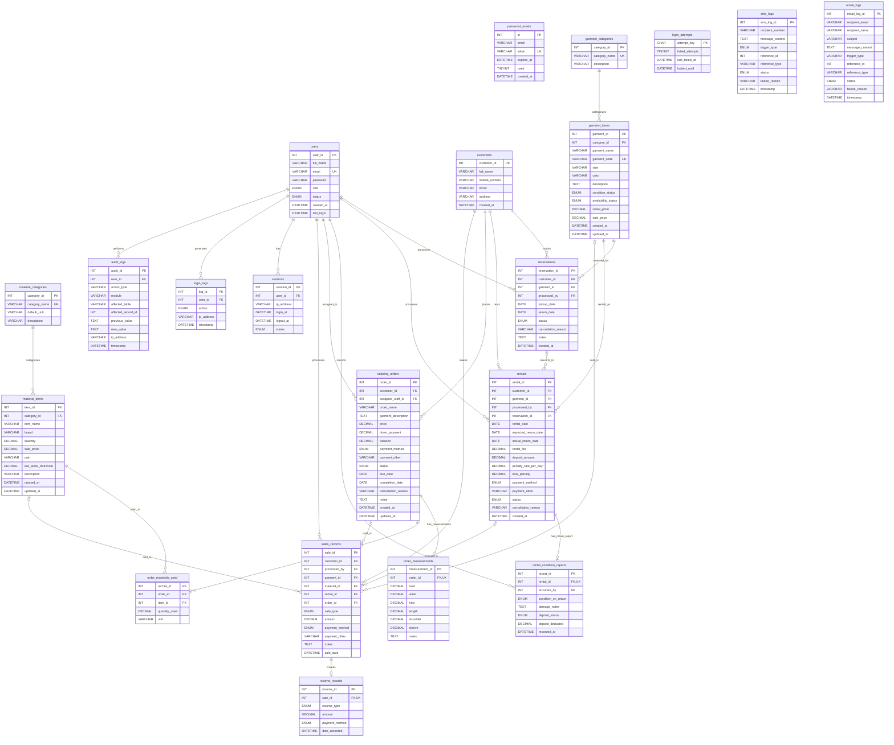

# Desire's Tailor Shop Database ERD

This entity-relationship diagram is based on the tables and declared foreign
keys in `tailorshop.sql`.

Notes:
- `balance` in `tailoring_orders` is a generated column (`price - down_payment`).
- `password_resets.email` is not declared as a foreign key to `users.email`.
- `login_attempts` and notification-log reference IDs are not declared with
  foreign-key constraints in the SQL schema, so no ER relationships are drawn
  for them.
- Optional foreign keys and one-to-one relationships are shown according to
  nullability and uniqueness in the schema.
